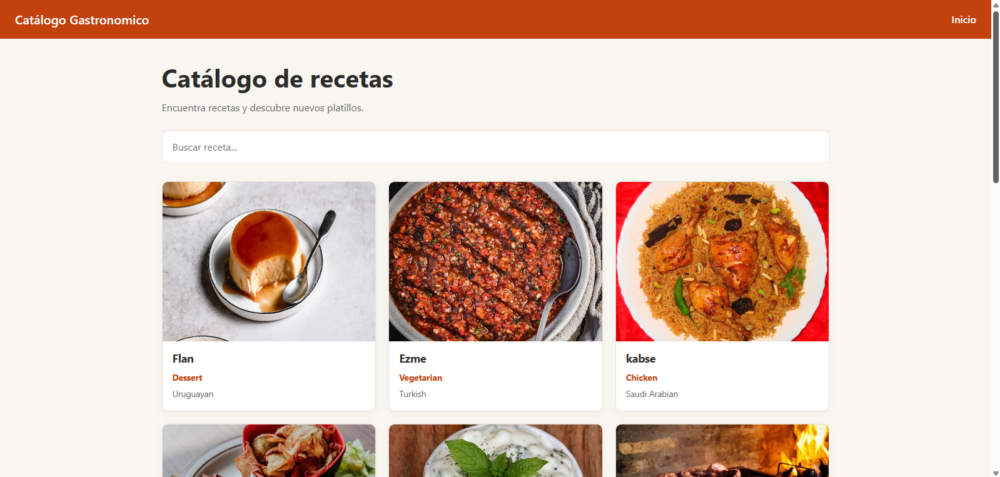
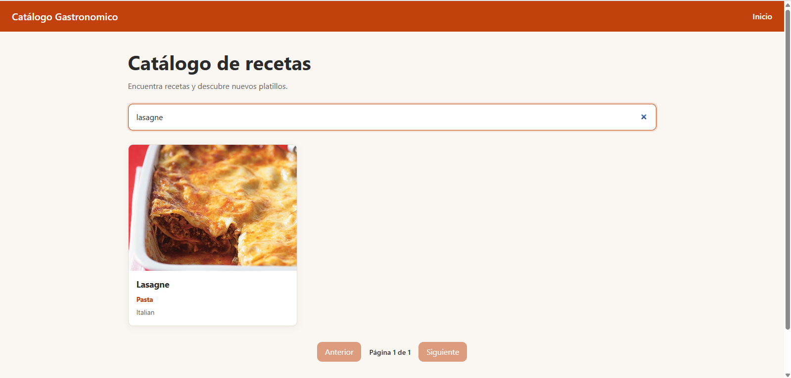
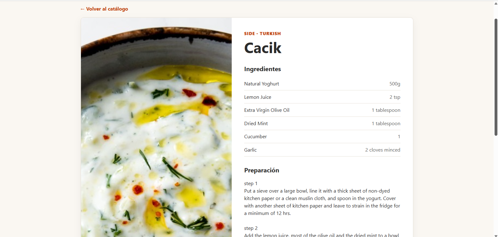
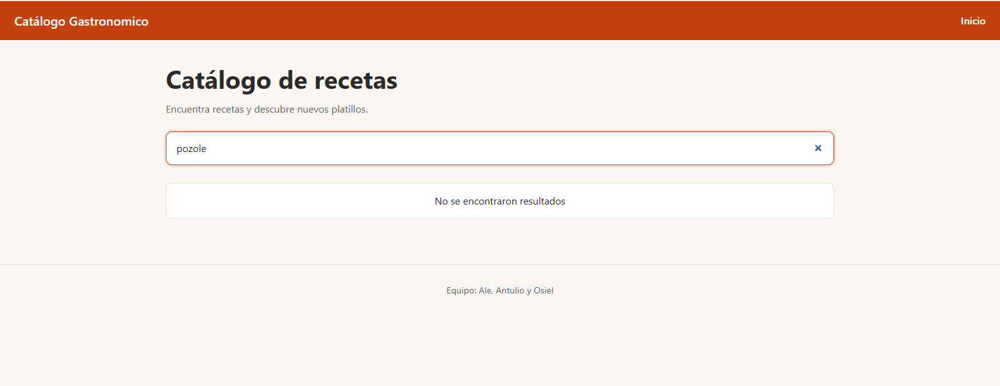

<!--
ARCHIVO: README.md
¿DE QUÉ TRATA?: Portada del repositorio. Es parte del PRODUCTO que pide la maestra (README con instrucciones, capturas y métricas + la fila de la matriz).
ASIGNADO A: Ale (Persona A) arma el esqueleto y lo integra; Antulio (B) y Osiel (C) llenan las secciones que dicen su nombre.
Cuando una sección esté lista, borra su comentario de HTML y deja solo el contenido.
-->

# Catálogo React

Aplicación web tipo "catálogo" hecha con **React** y **Vite** para la materia de Interacción de Servicios Digitales. Consume la API pública **TheMealDB** (recetas), muestra una lista con buscador por texto y permite ver el detalle de cada receta en otra ruta. 

## Equipo

| Persona | Responsable de |
|---|---|
| Alejandra | Base del proyecto, rutas, layout, mediciones de bundle y Lighthouse |
| Antulio | Listado, buscador y consumo de la API (lista) |
| Osiel| Detalle, estados de carga/error y medición de tiempo y líneas de código |

## Tecnologías

React, Vite, React Router, fetch nativo, CSS plano.

## Instrucciones para correrlo


1. git clone <url>
2. cd catalogo-react
3. cp .env.example .env
4. npm install
5. npm run dev      (desarrollo)
6. npm run build && npm run preview   (producción, la que se mide)


## Estructura del proyecto

```
catalogo-react/
├── docs/                      Documentación del equipo
│   ├── capturas/              Capturas de pantalla para el README
│   ├── INVESTIGACION.md       Investigación de React
│   ├── MATRIZ.md              Fila de la matriz comparativa
│   ├── METRICAS.md            Tiempo, líneas de código, bundle y Lighthouse
│   
│   
│   
├── src/
│   ├── componentes/           Piezas reutilizables de la interfaz
│   ├── estilos/               Archivos CSS
│   ├── hooks/                 Hooks propios (carga de datos, retraso del buscador)
│   ├── paginas/               Una página por ruta (inicio, detalle, 404)
│   ├── servicios/             Llamadas a la API
│   ├── utilidades/            Funciones auxiliares (normalizarReceta)
│   ├── App.jsx                Definición de rutas
│   ├── config.js              URL de la API y tamaño de página
│   └── main.jsx               Punto de entrada de la app
├── index.html                 Página HTML base
├── vite.config.js             Configuración de Vite
├── package.json               Dependencias y scripts
└── .env.example               Plantilla de variables de entorno
```

## Capturas

### Lista de recetas

### Buscador filtrando

### Vista de detalle

### Receta no encontrada

# Métricas
## 1. Tiempo de desarrollo
| Persona | Tarea | Inicio | Fin | Minutos |
|---|---|---|---|---|
| Ale | Repositorio y configuración del proyecto (Vite, dependencias, archivos base), formato de datos, rutas, estructura común, estilos globales, depuración, revisión y conexión del trabajo de los compañeros | 13:30 | 15:30 | 120 |
| Antulio | Lista de recetas: servicio de la API, hooks, página de inicio con buscador y paginación, tarjetas y estilos de la lista | 19:00 | 21:00 | 120 |
| Osiel | Detalle de receta: servicio, hook, página de detalle, página 404, mensajes de carga, error y sin resultados, y estilos | 18:00 | 19:00 | 60 |

## 2. Líneas de código
Comando usado: conteo de archivos `.js`, `.jsx` y `.css` en `src/`, sin líneas vacías ni líneas de comentario · Fecha: 10 nov 2026 (conteo del estado actual del árbol de trabajo; incluye el código fuente presente al medir).
| Tipo | Líneas |
|---|---|
| JS/JSX | 401 |
| CSS | 185 |
| **Total** | 586 |

### Tamaño del bundle de producción
Medido con `npm run build` (Vite 8.3.7):

| Archivo | Tamaño (kB) | Gzip (kB) |
|---|---|---|
| index.html | 1.00 | 0.63 |
| index-BWGeQ5hG.css | 4.97 | 1.53 |
| index-eO8ehAe1.js | 265.43 | 84.33 |

**Bundle de JavaScript (gzip): 84.33 kB**

### Lighthouse
Medido con `npm run preview`, Chrome en incógnito, modo móvil.

| Performance | Accessibility | Best Practices | SEO |
|---|---|---|---|
| 100 | 100 | 96 | 82 |

Métricas de rendimiento: First Contentful Paint 1.5 s, Largest Contentful Paint 1.5 s, Total Blocking Time 0 ms, Cumulative Layout Shift 0, Speed Index 1.5 s.Tiempo de desarrollo: pendiente de los registros del equipo. Código fuente: **266 líneas** (171 JS/JSX y 95 CSS; sin comentarios ni líneas en blanco).

## Fila de la matriz comparativa (React)

| Framework | Reactividad | Renderizado | Bundle (kB) | Lighthouse | Curva de aprendizaje | Caso de uso ideal |
|---|---|---|---|---|---|---|
| **React** (con Vite o Next.js) | Al actualizarse el estado, React vuelve a renderizar el componente y reconcilia el resultado con el DOM | CSR con Vite; SSR/SSG disponibles mediante frameworks como Next.js | 84.33 kB (JS gzip, medido) | 100 / 100 (Performance móvil) | Media: JSX y hooks se aprenden rápido; el ecosistema pide decidir router/estado/fetching | SPAs y dashboards complejos con mucho ecosistema; con Next.js, sitios que necesitan SEO |
